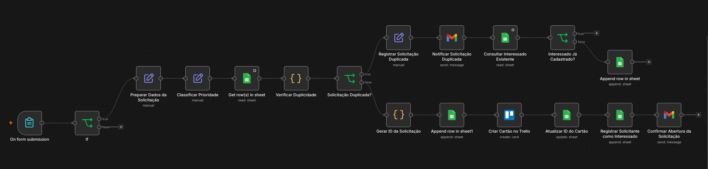
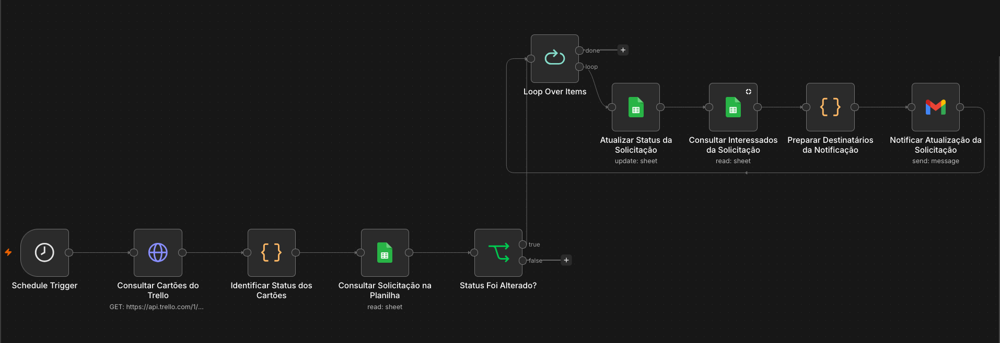

# Central de Manutenção — Automação de Solicitações

**Projeto de portfólio | n8n · Trello · Google Sheets · Gmail · JavaScript**

Sistema de automação para registrar solicitações de manutenção, evitar abertura de chamados duplicados, acompanhar alterações de status e enviar comunicações automáticas aos envolvidos.

> **Contexto:** projeto desenvolvido durante um bootcamp de Engenharia de Automação. Os arquivos publicados são versões de demonstração, com referências de ambiente removidas. Não representam uma implantação em produção nem métricas de resultado de clientes.

## Problema

O acompanhamento manual de solicitações de manutenção pode dispersar informações entre formulários, planilhas, quadros de tarefas e e-mails. O projeto reúne essas etapas em dois workflows complementares para reduzir a necessidade de lançamentos e conferências manuais.

## Visualização dos workflows

### D9 — Abertura de Solicitações



### D10 — Acompanhamento e Notificações



## Arquitetura

```text
[Abertura]
Formulário n8n
    ↓
Validar unidade × equipamento
    ↓
Preparar dados e classificar prioridade
    ↓
Consultar planilha e verificar duplicidade
    ├── Duplicada → avisar solicitante → verificar/cadastrar interessado
    └── Nova → gerar protocolo → registrar na planilha
                                   ↓
                             criar cartão Trello
                                   ↓
                          vincular ID do cartão
                                   ↓
                     cadastrar interessado e confirmar abertura

[Acompanhamento]
Agendamento → consultar cartões Trello → identificar status
    ↓
Localizar solicitação na planilha → comparar status
    ↓
Se houve alteração: atualizar registro → consultar interessados
    ↓
Preparar destinatários sem duplicação → enviar e-mails
```

## Funcionalidades

### Abertura de Solicitações

- Formulário com identificação da unidade, equipamento, problema, solicitante e impacto operacional.
- Validação de correspondência entre unidade e equipamento.
- Classificação de prioridade conforme o impacto informado: **Crítica**, **Alta** ou **Normal**.
- Consulta a registros existentes para evitar solicitações abertas com o mesmo equipamento e tipo de problema.
- Aviso por e-mail quando uma solicitação equivalente já existe, com controle de interessados.
- Para novas solicitações: geração de protocolo, registro em Google Sheets, criação de cartão no Trello e confirmação por e-mail.

### Sincronização de Status e Notificações

- Execução agendada para consultar cartões do Trello.
- Tradução das listas do quadro para status: **A Fazer**, **Em Andamento**, **Aguardando Peças** e **Concluída**.
- Comparação entre status do Trello e status registrado no Google Sheets.
- Atualização de registros quando uma mudança é detectada.
- Preparação de notificações para o solicitante e interessados vinculados ao chamado.
- Validação básica de formato de e-mail e eliminação de destinatários repetidos por endereço.

## Tecnologias e conceitos

| Tecnologia | Aplicação |
|---|---|
| n8n | Orquestração dos dois workflows |
| Trello / API REST | Gestão de cartões e acompanhamento do status |
| Google Sheets | Registro e consulta de solicitações e interessados |
| Gmail | Confirmações e notificações automáticas |
| JavaScript | Verificação de duplicidade, geração de protocolo e preparação de destinatários |
| Condições e loops | Validações, desvios e processamento de itens |

## Arquivos do projeto

- `workflows/D9-abertura-solicitacoes.json` — formulário, classificação, prevenção de duplicidade e abertura do chamado.
- `workflows/D10-acompanhamento-status.json` — sincronização dos status e notificações.

## Como reproduzir

1. Tenha uma instância do **n8n** e acesso ao **Trello**, **Google Sheets** e **Gmail**.
2. Importe cada arquivo JSON como um workflow no n8n.
3. Configure suas próprias credenciais nas integrações.
4. Crie uma planilha com abas de **Solicitacoes** e **Interessados**, contendo as colunas utilizadas pelos nodes. Revise o mapeamento de colunas após a importação.
5. Substitua os valores `CONFIGURAR_...` pelos identificadores de sua planilha, abas, quadro e listas do Trello.
6. Ajuste no node **Identificar Status dos Cartões** os IDs das listas do seu quadro para os respectivos status.
7. Teste o D9 com uma nova solicitação e com uma solicitação duplicada; depois teste o D10 alterando o status de um cartão.
8. Verifique os resultados na planilha e os e-mails antes de ativar os workflows.

> **Atenção:** os JSONs foram preparados para divulgação e **não foram validados por uma importação e execução completas após a sanitização**. Configurações dependentes do ambiente devem ser revisadas. Não utilize dados reais de clientes nos testes.

## Regras e limitações

- A prevenção de duplicidade do D9 considera **equipamento + tipo de problema**, desde que a solicitação anterior não esteja concluída.
- O D10 usa um mapeamento explícito entre IDs de listas do Trello e status; esse mapeamento deve ser adaptado em outro quadro.
- A lógica de notificação foi projetada para evitar mensagens repetidas quando não há mudança de status. Esse comportamento deve ser confirmado em testes de ponta a ponta no ambiente configurado.
- Este projeto não inclui painel próprio, autenticação de usuários finais ou métricas comprovadas de ganho de produtividade.

## Autor

**Samir Martinez** — estudos e projetos em Engenharia de Automação, integrações e IA aplicada.
